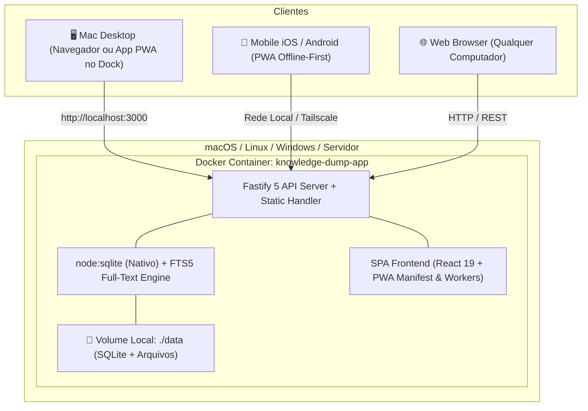

# Knowledge Dump 🧠📚

> **Personal Knowledge Management & Research Engine**  
> Um "Google Pessoal" soberano e Local-First que combina a flexibilidade de editores modernos de anotação com a densidade hipertextual enciclopédica da Wikipédia e suporte a referências de pesquisa.

---

## 💡 Ideia Principal do Projeto

O **Knowledge Dump** foi concebido para resolver o problema da fragmentação de notas, leituras acadêmicas e estudos temáticos. Em vez de notas isoladas em pastas estanques, o sistema opera sob o paradigma de **rede de conhecimento conectada**:

- **Hiperlinks Estilo Wikipédia:** Conexões imediatas com sintaxe de Wikilinks (`[[Nome da Nota]]` ou `[[Nome da Nota#Seção]]`), backlinks automáticos e popovers de prévia ao passar o mouse.
- **Editor Rico e Científico:** Suporte integrado a Markdown, blocos de código com destaque e fórmulas matemáticas em LaTeX renderizadas instantaneamente com KaTeX.
- **Soberania e Local-First:** Todos os dados, índices de busca e referências pertencem ao usuário e são persistidos no volume local em banco relacional SQLite.
- **Multiplataforma Descomplicada (Docker-First & PWA):** Execução universal no macOS, Linux, Windows ou servidores domésticos através de um único comando Docker, com instalação de aplicativo nativo via PWA no Mac (Dock) e celulares (iOS/Android).
- **Compartilhamento Flexível:** Possibilidade de compartilhar notas publicamente com link único, incluindo ou não a cascata de fontes citadas e notas vinculadas.

---

## 🏛️ Arquitetura do Sistema

A aplicação adota o modelo **Docker-First & Progressive Web App (PWA)**, garantindo que o acervo possa ser hospedado localmente no computador pessoal ou em um servidor privado, com acesso contínuo a partir de múltiplos dispositivos:



### Princípios Arquiteturais:
1. **Banco Embutido sem Dependências Externas:** Uso do módulo nativo `node:sqlite` do Node.js 22 com tabelas virtuais **FTS5** (Full-Text Search) para busca de notas em menos de 500ms.
2. **Separação Limpa de Camadas:** Frontend SPA reativo em React 19 consumindo endpoints REST do backend Fastify. Em produção (Docker), o próprio Fastify entrega tanto a API quanto a SPA estática otimizada.
3. **Persistência Exposta:** O container mapeia o diretório `./data` do host para `/app/data`, assegurando que desligar ou atualizar o container nunca resulte em perda de dados.

---

## 🛠️ Tecnologias e Versões Utilizadas

| Componente | Tecnologia | Versão | Função no Projeto |
| :--- | :--- | :--- | :--- |
| **Runtime & Servidor** | **Node.js** | `22.x` (Alpine no Docker) | Execução do servidor backend e compilação do frontend. |
| **Backend Framework** | **Fastify** | `^5.2.1` | Servidor HTTP de altíssimo desempenho para a API REST e arquivos estáticos. |
| **Banco de Dados** | **node:sqlite (SQLite 3 + FTS5)** | Nativo Node 22 | Persistência relacional local, triggers de integridade e motor de busca textual. |
| **Frontend Framework** | **React** | `19.0.0` | Biblioteca central de interface declarativa e reativa. |
| **Linguagem** | **TypeScript** | `^5.7.3` | Tipagem estática fim-a-fim entre schemas de banco, rotas e componentes. |
| **Build Tool & Dev Server**| **Vite** | `^6.2.0` | Ferramenta de build moderna e recarregamento ultrarrápido (HMR). |
| **Suporte PWA** | **vite-plugin-pwa** | `^0.21.1` | Geração de Service Workers, manifesto Web e capacidades offline. |
| **Editor Rich-Text** | **Tiptap (ProseMirror)** | `^3.32.0` | Editor visual expansível com suporte a Markdown, Wikilinks e âncoras. |
| **Motor Matemático** | **KaTeX** | `^0.19.0` | Renderização ultra-rápida de notação matemática e fórmulas LaTeX. |
| **Ícones** | **Lucide React** | `^0.475.0` | Conjunto leve de ícones SVG consistentes e acessíveis. |
| **Containerização** | **Docker & Docker Compose**| Engine v2+ / Compose v2 | Empacotamento multi-stage reproduzível em qualquer sistema operacional. |

---

## 🚀 Instruções para Rodar o Projeto

### Pré-requisitos
- **Modo Docker:** [Docker Desktop](https://www.docker.com/products/docker-desktop/) (macOS, Windows) ou Docker Engine + Docker Compose (Linux).
- **Modo Desenvolvimento Local:** [Node.js](https://nodejs.org/) versão `22.0.0` ou superior e `npm`.

---

### Opção 1: Execução com Docker (Recomendado)

Esta é a maneira mais simples de rodar a aplicação pronta para produção:

1. **Clonar o repositório:**
   ```bash
   git clone https://github.com/victor-reghini/knowledge-dump.git
   cd knowledge-dump
   ```

2. **Iniciar o container:**
   ```bash
   docker compose up -d
   ```

3. **Acessar a aplicação:**
   - Abra seu navegador em: **`http://localhost:3000`**
   - Os dados, notas e bancos de dados serão persistidos automaticamente na pasta `./data` da raiz do seu projeto.

4. **Encerrar a aplicação:**
   ```bash
   docker compose down
   ```

---

### Opção 2: Desenvolvimento Local

Para desenvolver novas funcionalidades ou executar testes localmente sem Docker:

1. **Instalar as dependências:**
   ```bash
   npm install
   ```

2. **Iniciar os servidores em modo de desenvolvimento:**
   ```bash
   npm run dev:all
   ```
   *Este comando inicia simultaneamente o backend Fastify (porta 3001) e o Vite Dev Server com HMR (porta 3000 com proxy automático para `/api`).*

3. **Acessar o ambiente de desenvolvimento:**
   - Acesse **`http://localhost:3000`** no navegador.

4. **Outros scripts disponíveis:**
   - `npm run build` — Compila tanto o cliente React quanto o servidor TypeScript para a pasta `dist/`.
   - `npm run start` — Inicia o servidor Node.js compilado em produção.
   - `npm run dev:server` — Inicia apenas a API Fastify com hot-reload (`tsx watch`).
   - `npm run dev` — Inicia apenas o frontend Vite.

---

### Opção 3: Instalação como App no Mac e Celular (PWA)

O Knowledge Dump suporta o padrão **PWA (Progressive Web App)**:

- **No macOS (Chrome, Brave ou Safari):**
  1. Acesse `http://localhost:3000` (ou o IP/domínio da sua máquina na rede local).
  2. Clique no ícone de **"Instalar Aplicativo"** na barra de endereços (ou em *Arquivo > Adicionar ao Dock* no Safari).
  3. O Knowledge Dump abrirá em uma janela própria, sem controles de navegador, podendo ser fixado no Dock do Mac.
- **No iOS (Safari):**
  1. Acesse a URL da sua aplicação no Safari do iPhone/iPad.
  2. Toque no botão de compartilhamento e selecione **"Adicionar à Tela de Início"**.
- **No Android (Chrome):**
  1. Acesse a URL no Chrome do celular.
  2. Toque no menu (três pontos) e selecione **"Instalar aplicativo"**.

---

## 📂 Estrutura de Diretórios

```
knowledge-dump/
├── .agents/            # Skills e perfis operacionais dos agentes autônomos
├── docs/               # Documentação técnica e de engenharia
│   ├── requisitos.md           # SRS / PRD formal com requisitos funcionais e BDD
│   ├── arquitetura_e_roadmap.md# Decisões arquiteturais, timeline e backlog
│   └── agentes/README.md       # Definição dos 3 agentes de desenvolvimento/testes
├── public/             # Arquivos estáticos e ícones PWA
├── scripts/            # Scripts utilitários de inicialização (dev.js)
├── server/             # Backend Fastify + node:sqlite
│   ├── db.ts           # Inicialização do banco relacional, schemas e FTS5
│   └── index.ts        # Rotas da API REST (notas, auth, busca, compartilhamento)
├── src/                # Frontend React 19 + TypeScript
│   ├── components/     # Componentes visuais (Editor, Sidebar, Directory, Modals)
│   ├── types.ts        # Definições de tipos compartilhados
│   ├── index.css       # Tokens de tema claro/escuro e Design System
│   ├── App.tsx         # Componente raiz com roteamento e gestão de estado
│   └── main.tsx        # Entrada da aplicação React e registro de Service Worker
├── CHANGELOG.md        # Histórico detalhado de lançamentos e versões
├── Dockerfile          # Build multi-stage enxuto (node:22-alpine)
├── docker-compose.yml  # Configuração de serviço e montagem do volume local
└── package.json        # Dependências e scripts do projeto
```

---

## 🤖 Governança e Agentes do Projeto

O desenvolvimento deste repositório é guiado por uma equipe de agentes especializados descritos em [docs/agentes/README.md](docs/agentes/README.md):
- **`agent-requirements`**: Engenharia de requisitos, manutenção do [requisitos.md](docs/requisitos.md) e regras de negócio.
- **`agent-testing`**: Garantia de qualidade, validação de critérios BDD e testes de carga/integridade.
- **`agent-development`**: Implementação das atividades do roadmap seguindo boas práticas de código enxuto (*Ponytail*) e sem ruídos desnecessários (*Anti-Slop*).

Consulte o [CHANGELOG.md](CHANGELOG.md) para conferir todas as funcionalidades entregues e o histórico de cada versão.
