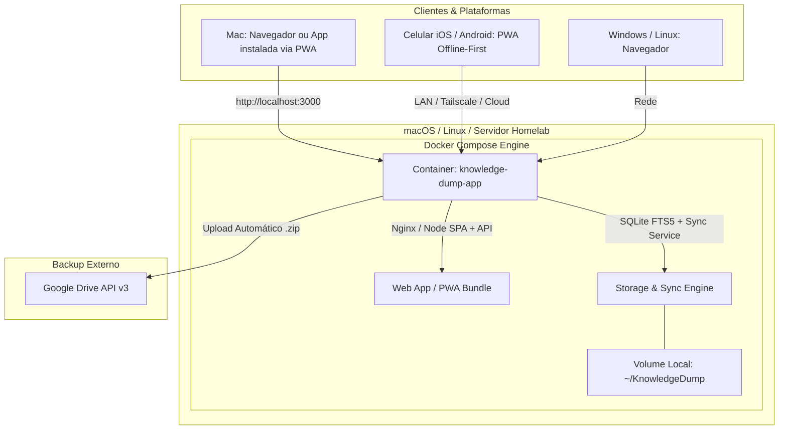
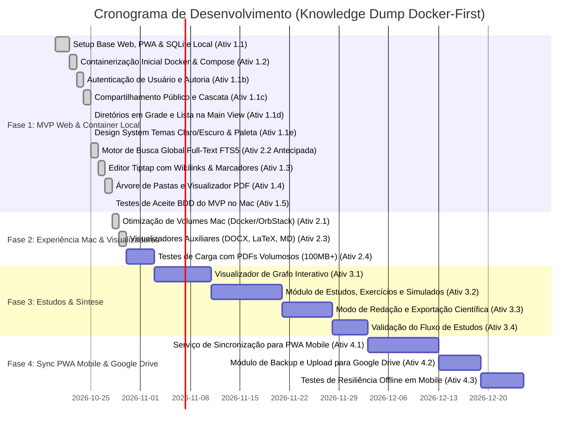

# Arquitetura Tecnológica e Roadmap de Implementação: Knowledge Dump (Docker & PWA)

**Versão:** 2.0.0  
**Estratégia de Distribuição:** **Docker-First & PWA** (Foco Web e macOS local via container, com acesso mobile via Progressive Web App).

---

## 1. Execução no macOS via Docker

**Sim, no Mac a execução via Docker é 100% possível e viável.**
- O usuário executa no macOS via **Docker Desktop**, **OrbStack** (mais leve) ou **Colima**.
- **Persistência e Soberania dos Dados:** O container mapeia um diretório local do Mac (ex.: `~/KnowledgeDump:/app/data`), garantindo que todas as notas em Markdown, referências e bancos SQLite permaneçam sob controle direto do usuário no disco rígido do Mac.
- **Experiência de Uso:** Ao subir o container (`docker compose up -d`), o usuário acessa em `http://localhost:3000` e pode "Instalar como Aplicativo" via Chrome/Safari/Brave (PWA), fixando um ícone nativo no Dock do macOS sem barra de endereços do navegador.

---

## 2. Visão Arquitetural

### 2.1. Detalhamento dos Componentes
| Camada | Tecnologia Escolhida | Justificativa Técnica |
| :--- | :--- | :--- |
| **Infraestrutura / Container** | **Docker + Docker Compose** | Multiplataforma nativo no Mac, Windows, Linux e VPS. Deploy com 1 comando (`docker compose up -d`) e isolamento de dependências. |
| **Frontend Core & PWA** | **React 19 + TypeScript + Vite + PWA Plugin** | Base reativa de altíssimo desempenho, instalável no Mac (Dock) e celular (Home Screen) com funcionamento offline garantido por Service Workers. |
| **Editor Rich-Text & Wikilinks** | **Tiptap (ProseMirror) + KaTeX** | Suporte avançado a Wikilinks `[[...]]`, âncoras, marcadores/bookmarks contextuais e renderização matemática ultra-rápida. |
| **Visualizador de PDF & Citações** | **PDF.js (Mozilla)** | Controle direto de coordenadas de texto e páginas para deep-linking e extração de trechos em Split-View. |
| **Banco de Dados Local & Busca** | **SQLite com FTS5 (montado no volume do Host)** | Desempenho relacional soberano, busca textual completa (< 500ms) e persistência direta na pasta do usuário no Mac. |
| **Sincronização & Backup** | **Sync Service Integrado + Google Drive REST API** | Sincroniza estado com clientes PWA móveis e gera backups compactados periódicos (.zip) enviados diretamente ao Google Drive. |

---

## 3. Linha do Tempo Gradativa (Roadmap Docker-First)

---

## 4. Backlog de Atividades Executáveis por Agente

---

### Fase 1: MVP Web & Container Local (macOS / Web)

#### Atividade 1.1: Inicialização do Core Web e Suporte a PWA [CONCLUÍDA ✅]
- **Status:** **CONCLUÍDA ✅**
- **Branch Utilizada:** `feature/fase-1-core-mvp-e-requisitos`
- **Responsável:** `agent-development`
- **Descrição:** Inicializar workspace React + TypeScript + Vite. Configurar suporte a PWA (Service Workers e Web App Manifest) e camada de banco SQLite persistente.
- **Entregas Realizadas:**
  - Configuração do Vite com `@vitejs/plugin-react` e `vite-plugin-pwa`.
  - Servidor backend Fastify com `node:sqlite` persistente (`server/db.ts` e `server/index.ts`).
  - Schema de dados inicial: tabelas `users`, `categories`, `folders`, `notes`, `note_sources`, `backlinks` e índice FTS5.

#### Atividade 1.1b: Autenticação de Usuário e Autoria de Notas (RF-36) [CONCLUÍDA ✅]
- **Status:** **CONCLUÍDA ✅**
- **Branch Utilizada:** `feature/fase-1-core-mvp-e-requisitos`
- **Responsável:** `agent-development`
- **Descrição:** Vincular as anotações do repositório a usuários autenticados com controle de credenciais (login/senha) e isolamento de acervo pessoal.
- **Entregas Realizadas:**
  - Componente modal `AuthModal.tsx` com alternância entre Login e Cadastro.
  - Hashing seguro SHA-256 no backend Fastify e gerenciamento de sessão via `x-user-id` e `localStorage`.
  - Associação automática do `user_id` em novas notas e leitura do autor.

#### Atividade 1.1c: Compartilhamento Público em Rede (RF-37) [CONCLUÍDA ✅]
- **Status:** **CONCLUÍDA ✅**
- **Branch Utilizada:** `feature/fase-1-core-mvp-e-requisitos`
- **Responsável:** `agent-development`
- **Descrição:** Permitir tornar notas públicas através de link compartilhável, com inclusão opcional em cascata de fontes citadas e notas relacionadas via Wikilinks.
- **Entregas Realizadas:**
  - Componente `ShareModal.tsx` com link de compartilhamento e toggles para cascata de fontes e notas conectadas.
  - Rota e visualizador de leitura pública `PublicNoteView.tsx` (`/p/:id`).
  - Endpoints dedicados `/api/notes/:id/share` e `/api/public/notes/:id`.

#### Atividade 1.1d: Navegação e Diretórios em Grade e Lista na Main View (RF-04) [CONCLUÍDA ✅]
- **Status:** **CONCLUÍDA ✅**
- **Branch Utilizada:** `feature/fase-1-core-mvp-e-requisitos`
- **Responsável:** `agent-development`
- **Descrição:** Ao selecionar qualquer pasta ou categoria na barra lateral, exibir diretamente as notas filtradas na área principal, permitindo alternar entre modo Lista e modo Grade (Cards).
- **Entregas Realizadas:**
  - Componente `NotesDirectoryView.tsx` integrado no painel central do `App.tsx`.
  - Controles de visualização em Lista (tabela com metadados) e Grade (cards com trecho, tags, badges de fontes e backlinks).
  - Correção de filtro de seleção na barra lateral (`Sidebar.tsx`) eliminando resets mútuos indesejados.

#### Atividade 1.1e: Design System, Paleta de Cores e Temas (RNF-04) [CONCLUÍDA ✅]
- **Status:** **CONCLUÍDA ✅**
- **Branch Utilizada:** `feature/fase-1-core-mvp-e-requisitos`
- **Responsável:** `agent-development`
- **Descrição:** Implementar design system com tema claro padrão, tema escuro em escala pura de cinza (sem tons azulados/roxos), cor primária em amarelo (pastel no claro, âmbar no escuro) com alto contraste (WCAG AA), e cores de destaque azul, verde e vermelho.
- **Entregas Realizadas:**
  - Tokens CSS em `src/index.css` para temas `light` e `dark` com variáveis semânticas.
  - Tema escuro neutro com cinzas (`#121212`, `#1e1e1e`, `#282828`).
  - Paleta amarela primária balanceada com contraste para textos e botões.
  - Cores funcionais para ações: azul (`--color-accent-blue`), verde (`--color-accent-green`) e vermelho (`--color-accent-red`).

#### Atividade 1.2: Containerização Inicial (Dockerfile e docker-compose.yml) [CONCLUÍDA ✅]
- **Status:** **CONCLUÍDA ✅**
- **Branch Utilizada:** `feature/fase-1-core-mvp-e-requisitos`
- **Responsável:** `agent-development`
- **Descrição:** Criar `Dockerfile` multi-stage (build enxuto) e `docker-compose.yml` configurado com mapeamento de volume para o diretório local do Mac/Host (`./data:/app/data`) e porta `3000`.
- **Entregas Realizadas:**
  - `Dockerfile` multi-stage baseado em `node:22-alpine` compilando frontend Vite e backend Fastify.
  - `docker-compose.yml` com volume `./data:/app/data`, `NODE_ENV=production` e porta 3000 exposta.

#### Atividade 1.3: Editor Tiptap com Wikilinks, Marcadores e Âncoras [CONCLUÍDA ✅]
- **Status:** **CONCLUÍDA ✅**
- **Branch Utilizada:** `feature/1.3-editor-tiptap-katex`
- **Responsável:** `agent-development`
- **Descrição:** Implementar editor rico baseado no Tiptap com extensões para Wikilinks `[[Nome da Nota]]`, âncoras `#`, fórmulas KaTeX e marcadores contextuais.
- **Entregas Realizadas:**
  - Integração do editor rico Tiptap (`@tiptap/react`, `@tiptap/starter-kit`) com toolbar de formatação (Títulos H1/H2/H3, Negrito, Itálico, Código, Listas, Citações).
  - Renderização matemática de alta precisão com KaTeX para expressões inline `$formula$` e blocos destacados `$$formula$$`.
  - Construtor interativo de fórmulas KaTeX com live preview e presets matemáticos (Sigmoide, Relatividade, Soma Gaussiana, Integral).
  - Construtor de Wikilinks com autocompletar de notas existentes e suporte a âncoras contextuais.
  - Preview flutuante ao passar o mouse sobre Wikilinks ([RF-11](file:///Users/victor/Documents/Projects/ComplexProjects/knowledge-dump/docs/requisitos.md#L74)) exibindo metadados, categoria, tags, contagem de backlinks e status.
  - Estilização diferenciada e criação sob demanda com 1 clique para links órfãos ([RF-09](file:///Users/victor/Documents/Projects/ComplexProjects/knowledge-dump/docs/requisitos.md#L72)).
  - Suporte a âncoras de cabeçalho `{#secao}` com scroll suave e ícones interativos de âncora ⚓ ([RF-08](file:///Users/victor/Documents/Projects/ComplexProjects/knowledge-dump/docs/requisitos.md#L71)).
  - Gestão de marcadores/marca-páginas contextuais com notas ([RF-05](file:///Users/victor/Documents/Projects/ComplexProjects/knowledge-dump/docs/requisitos.md#L65)).

#### Atividade 1.4: Navegação em Pastas e Visualizador PDF com Deep-Link [CONCLUÍDA ✅]
- **Status:** **CONCLUÍDA ✅**
- **Branch Utilizada:** `feature/1.4-visualizador-pdf-deeplink`
- **Responsável:** `agent-development`
- **Descrição:** Construir painel lateral de navegação em árvore e integrar PDF.js em modo Split-View com extração de citações vinculadas a páginas e parágrafos.
- **Entregas Realizadas:**
  - Componente de árvore hierárquica `FolderTree.tsx` com suporte a subpastas aninhadas infinitas, colapso/expansão, criação inline de pastas raiz e subpastas, e contagem recursiva de notas.
  - Visualizador embutido de PDF `PdfViewer.tsx` baseado em `pdfjs-dist` com suporte a paginação, zoom escalonável, rotação em 90°, busca textual na página e seleção de texto nativa (RF-14, RNF-03, RN-02).
  - Modo Split-View responsivo (`App.tsx`) dividindo a tela lado a lado entre o editor de anotações e o leitor de PDF, com toggles no cabeçalho e na barra de ferramentas.
  - Ferramenta de citação em seleção de texto com tooltip flutuante e inserção automática em bloco Markdown na nota ativa (RF-19).
  - Protocolo de deep-link `pdf://<refId>?page=<X>` com salto instantâneo e highlight para a página correspondente ao clicar em citações ou links em anotações (Cenário 2 de BDD).
  - Upload direto de papers PDF via `@fastify/multipart` e gestão de acervo em disco e no SQLite (`references_files` e `citations`).
  - Paper acadêmico de demonstração de 8 páginas gerado e persistido em `data/references/rosenblatt1958_perceptron.pdf`.
  - Suíte de testes automatizados `tests/atividade-1.4.test.ts` e script de teste multiplataforma `scripts/test.js`.

#### Atividade 1.5: Homologação de Aceite do MVP no Docker [CONCLUÍDA ✅]
- **Status:** **CONCLUÍDA ✅**
- **Branch Utilizada:** `test/1.5-homologacao-mvp-docker`
- **Responsável:** `agent-testing`
- **Descrição:** Testar a inicialização do container no macOS e validar os Cenários BDD 1 e 2 no navegador e no modo PWA instalado.
- **Entregas Realizadas:**
  - Suíte de testes BDD e homologação Docker implementada em `tests/homologacao-mvp-docker.test.ts`.
  - Validação dos requisitos do Cenário 1 BDD: extração de Wikilinks com regex, resolução de notas existentes vs órfãs com criação sob demanda, identificação de âncoras de cabeçalho `{#secao}` e higienização de preview flutuante.
  - Validação dos requisitos do Cenário 2 BDD: formatação de citação com deep-link `pdf://<refId>?page=<X>`, integridade da citação e vinculação no SQLite, e presença física do arquivo de referência `rosenblatt1958_perceptron.pdf` no volume de dados.
  - Validação de containerização: Dockerfile multi-stage com `node:22-alpine`, compilação paralela do client e server, injeção de `NODE_OPTIONS="--experimental-sqlite"`, e mapeamento de volume `./data:/app/data` no `docker-compose.yml`.
  - Validação de PWA: verificação dos artefatos `dist/manifest.webmanifest` e do Service Worker `dist/sw.js` com precache de assets offline gerados pelo `vite-plugin-pwa`.
  - Homologação real com execução de container Docker, verificação de `/api/health`, `/manifest.webmanifest` e persistência bidirecional de dados no SQLite montado no host.

---

### Fase 2: Experiência Desktop Mac & Motor de Busca Local

#### Atividade 2.1: Validação de Performance e Permissões de Volume no Mac [CONCLUÍDA ✅]
- **Status:** **CONCLUÍDA ✅**
- **Branch Utilizada:** `feature/2.1-otimizacao-volumes-mac`
- **Responsável:** `agent-development`
- **Descrição:** Otimizar permissões de leitura/escrita no volume montado no macOS (Docker Desktop / OrbStack) e configurar script rápido de inicialização (`./start-mac.sh`).
- **Entregas Realizadas:**
  - Criação do script interativo executável [`start-mac.sh`](file:///home/npd/Downloads/projects/knowledge-dump/start-mac.sh) para inicialização em 1 clique com suporte a OrbStack, Docker Desktop e Colima.
  - Verificação e ajuste preventivo de permissões no volume host (`./data` e `./data/references`) compatível com VirtioFS e gRPC FUSE no macOS.
  - Verificação de portas e polling ativo do endpoint `/api/health` com abertura automática no navegador padrão (`open http://localhost:3000` no macOS).
  - Otimizações de IOPS e tolerância a concorrência no SQLite com pragmas: `journal_mode = WAL`, `synchronous = NORMAL`, `busy_timeout = 5000`, `cache_size = -64000` (64MB) e `temp_store = MEMORY`.
  - Suíte de testes automatizados [`tests/atividade-2.1.test.ts`](file:///home/npd/Downloads/projects/knowledge-dump/tests/atividade-2.1.test.ts) validando sintaxe Bash, permissões de arquivo, pragmas e throughput em rajadas de escrita.

#### Atividade 2.2: Motor de Busca Global Full-Text (FTS5) [CONCLUÍDA ANTECIPADAMENTE 🚀]
- **Status:** **CONCLUÍDA ANTECIPADAMENTE 🚀** (Implementada na integração do backend SQLite da Fase 1)
- **Branch Utilizada:** `feature/fase-1-core-mvp-e-requisitos`
- **Responsável:** `agent-development`
- **Descrição:** Criar índices virtuais FTS5 no SQLite do container e implementar o modal de busca rápida com operadores lógicos e filtros avançados.
- **Entregas Realizadas:**
  - Tabela virtual `notes_fts` com triggers de sincronização automática para inserção, atualização e exclusão.
  - Endpoint `/api/search?q=` consultando FTS5 com ranking de relevância (`snippet()`).
  - Modal de busca global com atalho de teclado `Cmd+K` / `Ctrl+K` integrado na UI.

#### Atividade 2.3: Visualizadores de DOCX, LaTeX e Mídia [CONCLUÍDA ✅]
- **Status:** **CONCLUÍDA ✅**
- **Branch Utilizada:** `feature/2.3-visualizadores-docx-latex-midia`
- **Responsável:** `agent-development`
- **Descrição:** Incluir renderizadores embutidos para `.docx`, `.tex` e reprodutor de áudio/vídeo com marcação de timestamps.
- **Entregas Realizadas:**
  - Criação do extrator e parser nativo de DOCX (`server/docx.ts`) com descompactação ZIP sem dependências externas via `node:zlib`, preservando títulos, parágrafos, negrito/itálico e tabelas.
  - Componente [`DocxViewer.tsx`](file:///home/npd/Downloads/projects/knowledge-dump/src/components/DocxViewer.tsx) (RF-15) com renderização rica em formato de página de texto, zoom escalonável, busca textual interna e tooltip flutuante de citação direta com deep-link `docx://<id>?p=<num>`.
  - Componente [`LatexViewer.tsx`](file:///home/npd/Downloads/projects/knowledge-dump/src/components/LatexViewer.tsx) (RF-16) com modos "Formatado (KaTeX)", "Código-Fonte TeX" e "Lado a Lado (Split)", números de linha, busca e citação direta com deep-link `tex://<id>?line=<num>`.
  - Componente [`MediaViewer.tsx`](file:///home/npd/Downloads/projects/knowledge-dump/src/components/MediaViewer.tsx) (RF-18) com player de vídeo/áudio com seletor de velocidade (0.75x a 2x), indicador de tempo em tempo real, citação com marcação de timestamp (`media://<id>?t=<secs>`) e visualizador de imagem com zoom/pan e rotação 90°.
  - Componente unificador [`ReferenceViewer.tsx`](file:///home/npd/Downloads/projects/knowledge-dump/src/components/ReferenceViewer.tsx) integrado no painel Split-View com roteamento dinâmico de tipo de arquivo.
  - Expansão do upload em [`Sidebar.tsx`](file:///home/npd/Downloads/projects/knowledge-dump/src/components/Sidebar.tsx) para múltiplos formatos com ícones semânticos distintos para PDF, DOCX, TeX, Vídeo, Áudio e Imagem.
  - Generalização do parser de badges de deep-link em [`NoteEditor.tsx`](file:///home/npd/Downloads/projects/knowledge-dump/src/components/NoteEditor.tsx) para saltar diretamente para páginas de PDF, parágrafos de DOCX, linhas de LaTeX ou timestamps de vídeo/áudio.
  - Suíte de testes automatizados [`tests/atividade-2.3.test.ts`](file:///home/npd/Downloads/projects/knowledge-dump/tests/atividade-2.3.test.ts) cobrindo todos os cenários.

#### Atividade 2.4: Testes de Carga e Arquivos Volumosos [CONCLUÍDA ✅]
- **Status:** **CONCLUÍDA ✅**
- **Branch Utilizada:** `test/2.4-testes-carga-arquivos-volumosos`
- **Responsável:** `agent-testing`
- **Descrição:** Validar performance de indexação e leitura de arquivos pesados (PDFs de 100MB+) dentro do container.
- **Entregas Realizadas:**
  - Implementação de streaming com suporte completo a requisições parciais HTTP Byte-Range (RFC 7233) em [`server/index.ts`](file:///home/npd/Downloads/projects/knowledge-dump/server/index.ts) (`Accept-Ranges: bytes`, status 206 Partial Content e status 416 Range Not Satisfiable), permitindo carregamento sob demanda de blocos de páginas em documentos PDF e mídias sem download integral prévio.
  - Otimização do upload multipart em [`server/index.ts`](file:///home/npd/Downloads/projects/knowledge-dump/server/index.ts) utilizando streaming direto para disco via `stream/promises.pipeline`, garantindo consumo de memória O(1) e protegendo contra estouro de heap V8 em arquivos de 150MB+ (RNF-03).
  - Otimização assíncrona do loop de busca em documentos PDF em [`src/components/PdfViewer.tsx`](file:///home/npd/Downloads/projects/knowledge-dump/src/components/PdfViewer.tsx), com liberação periódica do event loop a cada 8 páginas e teto de resultados para evitar congelamento da UI em livros extensos.
  - Suíte de testes automatizados de carga e estresse em [`tests/atividade-2.4.test.ts`](file:///home/npd/Downloads/projects/knowledge-dump/tests/atividade-2.4.test.ts), validando:
    1. Streaming parcial via Range requests com arquivo esparso de 105MB (110.100.480 bytes) com marcadores binários no início, meio (50MB) e trailer EOF final.
    2. Tempo de resposta de I/O inferior a 25ms para leitura de páginas aleatórias de 64KB e variação de memória heap controlada (< 15MB).
    3. Inserção em lote de 1.000 notas acadêmicas com índice FTS5 ativo e busca concorrente com latência < 50ms (atendendo ao RNF-01).
    4. Integridade de catálogo e URLs de streaming sem alocação desnecessária de texto em memória.

---

### Fase 3: Grafo de Conhecimento, Aprendizagem & Produção Científica

#### Atividade 3.1: Mapa Interativo em Grafo [PENDENTE ⏳]
- **Status:** **PENDENTE ⏳**
- **Branch Prevista:** `feature/3.1-mapa-grafo-interativo`
- **Responsável:** `agent-development`
- **Descrição:** Implementar visualização interativa do grafo com física de forças (Force-Graph) e filtros por densidade e categorias.

#### Atividade 3.2: Módulo de Planos de Estudo e Exercícios [PENDENTE ⏳]
- **Status:** **PENDENTE ⏳**
- **Branch Prevista:** `feature/3.2-planos-estudo-exercicios`
- **Responsável:** `agent-development`
- **Descrição:** Construir trilhas de estudo, banco de questões com gabarito comentado e simulados avaliativos.

#### Atividade 3.3: Modo de Redação e Exportação Científica [PENDENTE ⏳]
- **Status:** **PENDENTE ⏳**
- **Branch Prevista:** `feature/3.3-redacao-exportacao-cientifica`
- **Responsável:** `agent-development`
- **Descrição:** Criar ambiente focado de composição com gaveta de citações e compilação em Markdown, PDF, LaTeX e DOCX.

#### Atividade 3.4: Validação do Fluxo de Estudos [PENDENTE ⏳]
- **Status:** **PENDENTE ⏳**
- **Branch Prevista:** `test/3.4-validacao-fluxo-estudos`
- **Responsável:** `agent-testing`
- **Descrição:** Validar o Cenário 3 de BDD (exercício com vínculo conceitual) e consistência das exportações.

---

### Fase 4: Sincronização PWA Mobile & Integração Google Drive

#### Atividade 4.1: API de Sincronização Incremental para Clientes PWA [PENDENTE ⏳]
- **Status:** **PENDENTE ⏳**
- **Branch Prevista:** `feature/4.1-sync-incremental-pwa`
- **Responsável:** `agent-development`
- **Descrição:** Implementar endpoint leve no container para sincronização diferencial com clientes PWA móveis (smartphones), suportando edição offline e resolução de conflitos (RN-06).

#### Atividade 4.2: Backup Geral com Upload Direto para o Google Drive [PENDENTE ⏳]
- **Status:** **PENDENTE ⏳**
- **Branch Prevista:** `feature/4.2-backup-google-drive`
- **Responsável:** `agent-development`
- **Descrição:** Desenvolver funcionalidade de geração de pacote `.zip` completo do acervo e upload automatizado via Google Drive REST API v3 com OAuth2.

#### Atividade 4.3: Homologação Mobile e Resiliência Offline [PENDENTE ⏳]
- **Status:** **PENDENTE ⏳**
- **Branch Prevista:** `test/4.3-homologacao-mobile-offline`
- **Responsável:** `agent-testing`
- **Descrição:** Validar instalação PWA no smartphone (iOS Safari / Android Chrome), edição sem internet e integridade do backup no Google Drive (Cenário BDD 4).

---

## 5. Política Obrigatória de Git Branching e Entregas

Em conformidade com as diretrizes do projeto:
1. **Nunca realizar commits diretamente na branch `main`**.
2. **Cada nova atividade ou correção deve ser executada em uma branch dedicada**:
   - Funcionalidades: `feature/<id-da-atividade>-<slug>` (ex: `feature/1.3-editor-tiptap-katex`)
   - Correções e bugs: `hotfix/<slug>` (ex: `hotfix/layout-backlinks-overlap`)
   - Documentação: `docs/<slug>` (ex: `docs/atualizacao-roadmap`)
   - Testes e homologação: `test/<slug>` (ex: `test/1.5-homologacao-mvp-docker`)
3. **Fluxo de Conclusão**:
   - Validação da atividade (testes unitários/BDD ou inspeção em navegador).
   - Commit semântico (Conventional Commits: `feat:`, `fix:`, `docs:`, `test:`).
   - Merge ou Pull Request para integração controlada.

