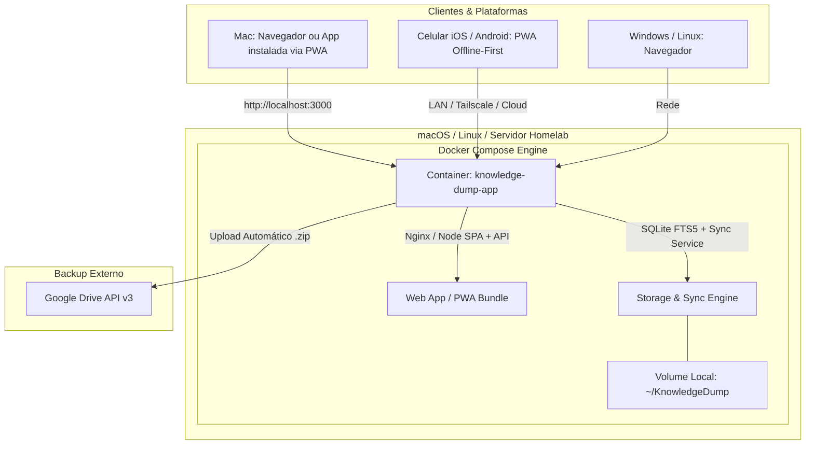
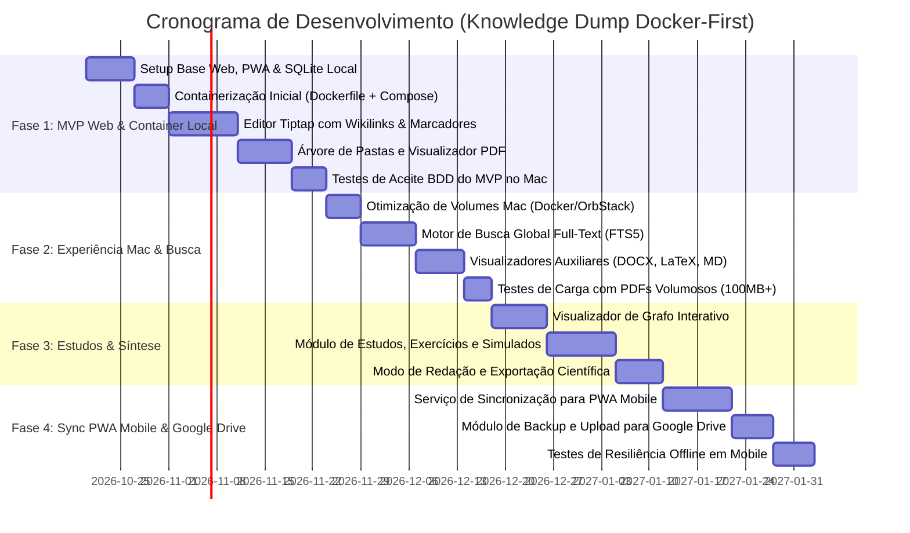

# Arquitetura Tecnológica e Roadmap de Implementação: Knowledge Dump (Docker & PWA)

**Versão:** 2.0.0  
**Estratégia de Distribuição:** **Docker-First & PWA** (Foco Web e macOS local via container, com acesso mobile via Progressive Web App).

---

## 1. Execução no macOS via Docker

**Sim, no Mac a execução via Docker é 100% possível e viável.**
- O usuário executa no macOS via **Docker Desktop**, **OrbStack** (mais leve) ou **Colima**.
- **Persistência e Soberania dos Dados:** O container mapeia um diretório local do Mac (ex.: `~/KnowledgeDump:/app/data`), garantindo que todas as notas em Markdown, referências e bancos SQLite permaneçam sob controle direto do usuário no disco rígido do Mac.
- **Experiência de Uso:** Ao subir o container (`docker compose up -d`), o usuário acessa em `http://localhost:3000` e pode "Instalar como Aplicativo" via Chrome/Safari/Brave (PWA), fixando um ícone nativo no Dock do macOS sem barra de endereços do navegador.

---

## 2. Visão Arquitetural



### 2.1. Detalhamento dos Componentes
| Camada | Tecnologia Escolhida | Justificativa Técnica |
| :--- | :--- | :--- |
| **Infraestrutura / Container** | **Docker + Docker Compose** | Multiplataforma nativo no Mac, Windows, Linux e VPS. Deploy com 1 comando (`docker compose up -d`) e isolamento de dependências. |
| **Frontend Core & PWA** | **React 19 + TypeScript + Vite + PWA Plugin** | Base reativa de altíssimo desempenho, instalável no Mac (Dock) e celular (Home Screen) com funcionamento offline garantido por Service Workers. |
| **Editor Rich-Text & Wikilinks** | **Tiptap (ProseMirror) + KaTeX** | Suporte avançado a Wikilinks `[[...]]`, âncoras, marcadores/bookmarks contextuais e renderização matemática ultra-rápida. |
| **Visualizador de PDF & Citações** | **PDF.js (Mozilla)** | Controle direto de coordenadas de texto e páginas para deep-linking e extração de trechos em Split-View. |
| **Banco de Dados Local & Busca** | **SQLite com FTS5 (montado no volume do Host)** | Desempenho relacional soberano, busca textual completa (< 500ms) e persistência direta na pasta do usuário no Mac. |
| **Sincronização & Backup** | **Sync Service Integrado + Google Drive REST API** | Sincroniza estado com clientes PWA móveis e gera backups compactados periódicos (.zip) enviados diretamente ao Google Drive. |

---

## 3. Linha do Tempo Gradativa (Roadmap Docker-First)



---

## 4. Backlog de Atividades Executáveis por Agente

---

### Fase 1: MVP Web & Container Local (macOS / Web)

#### Atividade 1.1: Inicialização do Core Web e Suporte a PWA
- **Responsável:** `agent-development`
- **Descrição:** Inicializar workspace React + TypeScript + Vite. Configurar suporte a PWA (Service Workers e Web App Manifest) e camada de banco SQLite persistente.
- **Comando para o Agente:**
```bash
Inicialize a estrutura frontend Web em React 19 + TypeScript + Vite com suporte a PWA via vite-plugin-pwa. Configure o schema relacional inicial no SQLite para pastas, notas, tags, categorias e marcadores.
```

#### Atividade 1.2: Containerização Inicial (Dockerfile e docker-compose.yml)
- **Responsável:** `agent-development`
- **Descrição:** Criar `Dockerfile` multi-stage (build enxuto) e `docker-compose.yml` configurado com mapeamento de volume para o diretório local do Mac/Host (`./data:/app/data`) e porta `3000`.
- **Comando para o Agente:**
```bash
Crie o Dockerfile multi-stage otimizado e o arquivo docker-compose.yml para subir a aplicação Knowledge Dump localmente. Configure a montagem de volume para persistência dos dados no host e garanta que o build funcione com um único comando 'docker compose up -d'.
```

#### Atividade 1.3: Editor Tiptap com Wikilinks, Marcadores e Âncoras
- **Responsável:** `agent-development`
- **Descrição:** Implementar editor rico baseado no Tiptap com extensões para Wikilinks `[[Nome da Nota]]`, âncoras `#`, fórmulas KaTeX e marcadores (com e sem comentários contextuais).
- **Comando para o Agente:**
```bash
Implemente o componente de editor Tiptap com suporte a Markdown, fórmulas LaTeX/KaTeX, extensão customizada para Wikilinks [[Nota]], âncoras [[Nota#secao]] e marcadores/bookmarks com visualização de destaques e comentários.
```

#### Atividade 1.4: Navegação em Pastas e Visualizador PDF com Deep-Link
- **Responsável:** `agent-development`
- **Descrição:** Construir painel lateral de navegação em árvore e integrar PDF.js em modo Split-View com extração de citações vinculadas a páginas e parágrafos.
- **Comando para o Agente:**
```bash
Implemente o explorador lateral em árvore de pastas e o visualizador de PDF embutido (PDF.js) com suporte a painel duplo (Split-View) e ferramenta de citação com deep-link direto para a página e coordenadas do texto.
```

#### Atividade 1.5: Homologação de Aceite do MVP no Docker
- **Responsável:** `agent-testing`
- **Descrição:** Testar a inicialização do container no macOS e validar os Cenários BDD 1 e 2 no navegador e no modo PWA instalado.
- **Comando para o Agente:**
```bash
Valide a subida do container via Docker Compose no ambiente Mac/Web e execute os testes dos Cenários BDD 1 (navegação por Wikilinks) e 2 (citação em PDF com deep-link), checando a persistência dos arquivos no volume montado no host.
```

---

### Fase 2: Experiência Desktop Mac & Motor de Busca Local

#### Atividade 2.1: Validação de Performance e Permissões de Volume no Mac
- **Responsável:** `agent-development`
- **Descrição:** Otimizar permissões de leitura/escrita no volume montado no macOS (Docker Desktop / OrbStack) e configurar script rápido de inicialização (`./start-mac.sh`).
- **Comando para o Agente:**
```bash
Ajuste as configurações de volume no docker-compose.yml para evitar gargalos de I/O de disco no macOS. Crie um script utilitário start.sh para checar os pré-requisitos do Docker e abrir o navegador automaticamente na porta configurada.
```

#### Atividade 2.2: Motor de Busca Global Full-Text (FTS5)
- **Responsável:** `agent-development`
- **Descrição:** Criar índices virtuais FTS5 no SQLite do container e implementar o modal de busca rápida com operadores lógicos e filtros avançados.
- **Comando para o Agente:**
```bash
Implemente o motor de busca global full-text com SQLite FTS5 indexando o conteúdo de notas e textos extraídos de referências. Desenvolva o modal de busca com atalho de teclado (Cmd+K / Ctrl+K) e filtros por tags e pastas.
```

#### Atividade 2.3: Visualizadores de DOCX, LaTeX e Mídia
- **Responsável:** `agent-development`
- **Descrição:** Incluir renderizadores embutidos para `.docx`, `.tex` e reprodutor de áudio/vídeo com marcação de timestamps.
- **Comando para o Agente:**
```bash
Implemente os visualizadores in-app para documentos DOCX, código LaTeX (.tex com preview) e reprodutor multimídia com controle de velocidade e timestamps para citações.
```

#### Atividade 2.4: Testes de Carga e Arquivos Volumosos
- **Responsável:** `agent-testing`
- **Descrição:** Validar performance de indexação e leitura de arquivos pesados (PDFs de 100MB+) dentro do container.
- **Comando para o Agente:**
```bash
Execute testes de estresse carregando PDFs pesados (100MB+) e coleções de 5.000+ notas no container Docker. Verifique cumprimento do RNF-01 (busca < 500ms) e integridade da memória.
```

---

### Fase 3: Grafo de Conhecimento, Aprendizagem & Produção Científica

#### Atividade 3.1: Mapa Interativo em Grafo
- **Responsável:** `agent-development`
- **Descrição:** Implementar visualização interativa do grafo com física de forças (Force-Graph) e filtros por densidade e categorias.
- **Comando para o Agente:**
```bash
Desenvolva a visualização 2D/3D interativa do Grafo de Conhecimento conectando notas e referências através de Wikilinks com filtros de densidade e categorias.
```

#### Atividade 3.2: Módulo de Planos de Estudo e Exercícios
- **Responsável:** `agent-development`
- **Descrição:** Construir trilhas de estudo, banco de questões com gabarito comentado e simulados avaliativos.
- **Comando para o Agente:**
```bash
Implemente o módulo de Planos de Estudos com roteiros sequenciais, banco de questões vinculadas a notas conceituais e painel de simulados.
```

#### Atividade 3.3: Modo de Redação e Exportação Científica
- **Responsável:** `agent-development`
- **Descrição:** Criar ambiente focado de composição com gaveta de citações e compilação em Markdown, PDF, LaTeX e DOCX.
- **Comando para o Agente:**
```bash
Desenvolva o ambiente de Redação Científica focado e o pipeline de exportação de artigos com compilação automática das referências bibliográficas citadas.
```

#### Atividade 3.4: Validação do Fluxo de Estudos
- **Responsável:** `agent-testing`
- **Descrição:** Validar o Cenário 3 de BDD (exercício com vínculo conceitual) e consistência das exportações.
- **Comando para o Agente:**
```bash
Valide via testes automatizados e critérios BDD o fluxo completo de resolução de exercícios, feedback de gabarito comentado e consistência de exportação de artigos científicos.
```

---

### Fase 4: Sincronização PWA Mobile & Integração Google Drive

#### Atividade 4.1: API de Sincronização Incremental para Clientes PWA
- **Responsável:** `agent-development`
- **Descrição:** Implementar endpoint leve no container para sincronização diferencial com clientes PWA móveis (smartphones), suportando edição offline e resolução de conflitos (RN-06).
- **Comando para o Agente:**
```bash
Implemente o serviço de sincronização diferencial no container para atendimento aos clientes PWA móveis. Garanta que o cache offline local (IndexedDB) sincronize automaticamente com o SQLite do container ao restabelecer conexão.
```

#### Atividade 4.2: Backup Geral com Upload Direto para o Google Drive
- **Responsável:** `agent-development`
- **Descrição:** Desenvolver funcionalidade de geração de pacote `.zip` completo do acervo e upload automatizado via Google Drive REST API v3 com OAuth2.
- **Comando para o Agente:**
```bash
Implemente o módulo de Backup Geral: empacotamento completo do acervo em arquivo .zip padronizado e upload direto para a conta do usuário no Google Drive via autenticação OAuth2.
```

#### Atividade 4.3: Homologação Mobile e Resiliência Offline
- **Responsável:** `agent-testing`
- **Descrição:** Validar instalação PWA no smartphone (iOS Safari / Android Chrome), edição sem internet e integridade do backup no Google Drive (Cenário BDD 4).
- **Comando para o Agente:**
```bash
Execute a bateria de testes de validação PWA em dispositivos móveis simulados: teste edição offline, retorno online com sincronização no container Docker e integridade do arquivo gerado no backup para o Google Drive.
```
