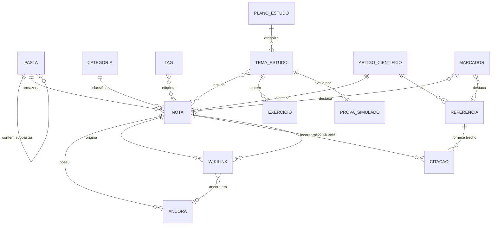

# Especificação de Requisitos do Sistema: Knowledge Dump

**Documento:** Especificação de Requisitos de Software (SRS / PRD)  
**Versão:** 1.0.0  
**Status:** Aprovado para Validação Inicial  
**Abordagem:** Agnóstico a tecnologias e arquitetura de implementação (serão definidas na fase seguinte).

---

## 1. Visão Geral do Produto

O **Knowledge Dump** é um repositório pessoal de conhecimento (*Personal Knowledge Management & Research Engine*), concebido para ser um "Google Pessoal" para estudantes, pesquisadores e profissionais intelectuais.

O sistema combina a flexibilidade e simplicidade de ferramentas de anotação (estilo Obsidian e Notion) com o rigor de relacionamentos hipertextuais enciclopédicos (estilo Wikipédia) e o suporte intensivo a referências acadêmicas e profissionais (papers em PDF, teses em LaTeX, documentos DOCX, HTML, vídeos e imagens).

A partir do acúmulo de notas, referências e planejamentos de estudo, o usuário pode sintetizar esse conhecimento para produzir artigos científicos, ensaios temáticos, relatórios técnicos e trilhas completas de aprendizado.

---

## 2. Modelo Conceitual do Domínio



### Entidades Principais
1. **Nota (Note)**: Unidade de anotação autoral do usuário, redigida com formatação rica/Markdown, fórmulas matemáticas e âncoras.
2. **Pasta / Subpasta**: Estrutura hierárquica para agrupamento de notas e referências em árvore.
3. **Categoria**: Classificação temática estrutural de alto nível (ex.: "Ciência da Computação", "Filosofia").
4. **Tag**: Marcador transversal flexível (ex.: `#algoritmos`, `#concurso2026`).
5. **Wikilink & Âncora**: Link bidirecional estilo Wikipédia que conecta termos e notas (`[[Título da Nota]]` ou `[[Título da Nota#Seção]]`).
6. **Referência / Arquivo Externo**: Documento importado que serve de base empírica ou bibliográfica (PDF, DOC/DOCX, LaTeX, HTML, vídeo, imagem).
7. **Citação Contextual (Deep-Link)**: Trecho extraído de uma referência que mantém vínculo direto com a página/seção exata do arquivo original.
8. **Plano de Estudos**: Estrutura de planejamento de aprendizagem com temas, metas, exercícios, provas e resumos de livros.
9. **Produção / Artigo Científico**: Documento compilado a partir de notas e referências selecionadas.
10. **Marcador / Marca-Página (Bookmark)**: Sinalizador visual e posicional para destacar notas, seções ou pontos em referências, permitindo destacar apenas para sinalização ou anexar comentários contextuais.

---

## 3. Requisitos Funcionais (RF)

### 3.1. Organização e Estrutura Hierárquica
- **RF-01 (Árvore de Pastas)**: O sistema deve permitir criar pastas e subpastas com profundidade arbitrária para acomodar notas e arquivos anexos.
- **RF-02 (Categorias)**: O sistema deve permitir definir categorias temáticas exclusivas ou complementares para agrupar notas e referências.
- **RF-03 (Tags Transversais)**: O sistema deve permitir associar múltiplas tags a qualquer nota ou arquivo de referência, com suporte a sugestão e autocompletar.
- **RF-04 (Múltiplas Vistas e Visualização de Pastas/Categorias)**: O sistema deve permitir visualizar itens por hierarquia de pastas, categorias, tags, marcadores ou linha do tempo. Ao acessar qualquer pasta ou categoria, o sistema deve exibir as notas contidas diretamente na área principal (Main View), permitindo ao usuário alternar entre **Visão em Lista** e **Visão em Grade (Cards)**.
- **RF-05 (Marcadores e Marca-Páginas / Bookmarks)**: O sistema deve permitir criar marcadores (estilo marca-páginas) em notas, seções ou pontos de documentos de referência (páginas de PDF, timestamps de áudio/vídeo ou parágrafos). O usuário pode utilizá-los tanto como um destaque simples (sem anotação, para sinalização e retorno rápido) quanto com anotações e comentários contextuais associados.


### 3.2. Editor de Anotações e Hiperlinks Estilo Wikipédia
- **RF-06 (Editor de Conteúdo Rico)**: O sistema deve fornecer editor de anotações com suporte a texto formatado, cabeçalhos hierárquicos, listas, tabelas, blocos de código com destaque de sintaxe e fórmulas matemáticas (estilo LaTeX / KaTeX).
- **RF-07 (Criação de Wikilinks)**: O usuário deve poder criar links rápidos entre notas digitando `[[Nome da Nota]]` ou selecionando trechos de texto e associando a uma nota existente ou nova.
- **RF-08 (Âncoras de Seção e Parágrafo)**: O usuário deve poder definir âncoras dentro do texto de uma nota para permitir que outras notas apontem para uma seção específica (`[[Nota#Âncora]]`).
- **RF-09 (Links Órfãos e Criação Sob Demanda)**: Se um Wikilink apontar para um termo ou nota que ainda não existe, o sistema deve estilizar o link com cor diferenciada (estilo "link vermelho da Wikipédia") e permitir criar a nova nota com 1 clique a partir desse link.
- **RF-10 (Backlinks e Relações Bidirecionais)**: Cada nota deve exibir automaticamente uma seção de "Notas que citam esta nota" (Backlinks) com trecho de contexto onde a menção ocorre.
- **RF-11 (Preview Flutuante ao Passar o Mouse)**: Ao repousar o cursor sobre qualquer Wikilink, o sistema deve exibir um pop-over (tooltip enriquecido) com resumo ou prévia da nota linkada sem exigir que o usuário saia da leitura atual.

### 3.3. Ingestão de Referências e Arquivos de Pesquisa
- **RF-12 (Suporte a Múltiplos Formatos)**: O sistema deve permitir importar e armazenar os seguintes formatos de arquivo de pesquisa:
  - Documentos de texto e diagramação: **PDF**, **DOC**, **DOCX**, **HTML**, **Markdown (.md)**, **LaTeX (.tex)**.
  - Mídias visuais e auditivas: Imagens (PNG, JPG, SVG, WebP), Vídeos (MP4, WebM), Áudios/Podcasts.
  - Links externos (URLs web) com extração de metadados (título, autor, descrição).
- **RF-13 (Metadados de Referência)**: O sistema deve permitir registrar metadados bibliográficos para referências importadas (Autores, Ano, Título, Periódico/Conferência, DOI, ISBN, URL).

### 3.4. Visualizadores Integrados (In-App Viewers)
- **RF-14 (Visualizador Nativo de PDF)**: O sistema deve incluir visualizador embutido de arquivos PDF com suporte a paginação, zoom, rotação, busca textual e seleção de texto.
- **RF-15 (Visualizador de Documentos Word)**: O sistema deve renderizar o conteúdo formatado de arquivos `.doc` e `.docx` diretamente na interface, sem dependência de softwares externos.
- **RF-16 (Visualizador de LaTeX)**: O sistema deve fornecer visualização de arquivos `.tex`, exibindo tanto o código-fonte quanto a prévia renderizada/formatada do documento.
- **RF-17 (Visualizador de HTML)**: O sistema deve renderizar páginas e artigos salvos em HTML em ambiente seguro (sandbox), preservando layout e imagens.
- **RF-18 (Visualizador de Imagens e Player de Mídia)**: O sistema deve exibir imagens com zoom/pan e reproduzir vídeos e áudios com controle de velocidade de reprodução (0.75x a 2x) e marcação de timestamp.

### 3.5. Sistema de Citações com Contexto Aprofundado (Deep-Linking)
- **RF-19 (Extração e Citação de Trechos)**: O usuário deve poder selecionar qualquer trecho de texto dentro de um visualizador (ex.: página 14 de um paper PDF) e clicar em "Citar na Anotação".
- **RF-20 (Deep-Link para Arquivo de Referência)**: Ao clicar em uma citação dentro de uma anotação, o sistema deve abrir o arquivo de referência correspondente diretamente na página, parágrafo ou timestamp exato de onde o trecho foi retirado.
- **RF-21 (Painel Duplo / Split View)**: O sistema deve permitir dividir a tela entre uma anotação em edição e o visualizador do arquivo de referência, facilitando fichamentos e análises simultâneas.

### 3.6. Módulo de Planejamento de Estudos e Aprendizagem
- **RF-22 (Criação de Planos e Cronogramas de Estudo)**: O usuário deve poder criar planos de estudo estruturados por disciplinas, fases ou objetivos (ex.: "Pós-graduação", "Concurso X").
- **RF-23 (Divisão por Temas e Roteiros)**: Cada plano de estudo deve permitir organizar tópicos sequenciais, associando notas obrigatórias, leituras recomendadas e metas temporais.
- **RF-24 (Banco de Exercícios)**: O sistema deve permitir cadastrar exercícios vinculados a temas e notas, com enunciado, opções (quando múltipla escolha), gabarito comentado e links para as notas teóricas que embasam a resposta.
- **RF-25 (Simulados e Provas)**: O usuário deve poder compilar exercícios em provas ou simulados com temporizador opcional, registro de acertos/erros e diagnóstico de temas que necessitam de revisão.
- **RF-26 (Fichamento e Resumos de Livros)**: O sistema deve fornecer templates específicos para resumos de livros e capítulos, com estrutura de teses centrais, argumentos secundários, citações-chave e impressões críticas do leitor.

### 3.7. Motor de Busca e Descoberta ("Google Pessoal")
- **RF-27 (Busca Global Full-Text)**: O sistema deve indexar e realizar buscas por palavras-chave tanto no corpo das anotações criadas quanto dentro do texto dos arquivos importados (PDFs pesquisáveis, DOCX, HTML, Markdown).
- **RF-28 (Filtros Avançados de Busca)**: A busca deve permitir operadores lógicos (AND, OR, NOT) e filtros por pasta, categoria, tags, tipo de arquivo e período de alteração.
- **RF-29 (Descoberta Semântica e Termos Relacionados)**: O sistema deve sugerir notas e referências que contenham temas correlatos à anotação que o usuário está lendo no momento.

### 3.8. Composição Científica e Síntese de Artigos
- **RF-30 (Modo de Redação de Artigos)**: O sistema deve prover um ambiente focado para redação de artigos e estudos temáticos, com painel lateral de consulta rápida ao acervo de notas e citações.
- **RF-31 (Compilação e Exportação)**: O sistema deve permitir compilar artigos e resumos nos formatos padrão de publicação (Markdown, PDF, LaTeX e DOCX), incluindo lista de referências bibliográficas citadas.

### 3.9. Grafo de Conhecimento
- **RF-32 (Visualização em Grafo)**: O sistema deve gerar um mapa visual interativo em forma de grafo de nós e arestas, onde nós representam notas/referências e arestas representam os links entre elas.
- **RF-33 (Filtros no Grafo)**: O usuário deve poder isolar agrupamentos de nós por categoria, tag ou densidade de conexões.

### 3.10. Sincronização em Nuvem, Autenticação e Compartilhamento
- **RF-34 (Sincronização Multi-Dispositivo)**: O sistema deve sincronizar notas, arquivos de referência, marcadores e configurações entre computadores e dispositivos móveis (smartphones/tablets) por meio de um serviço em nuvem, garantindo que edições efetuadas em um dispositivo sejam replicadas e acessíveis nos demais.
- **RF-35 (Backup Geral e Upload para Google Drive)**: O sistema deve permitir gerar um pacote de backup/exportação completo de todo o acervo (notas, arquivos anexos, índices e metadados) e realizar o envio (upload) direto para a conta do usuário no Google Drive via integração com o serviço.
- **RF-36 (Autenticação e Autoria de Notas)**: As anotações do sistema devem estar associadas a um usuário devidamente autenticado via login e senha. O sistema deve garantir a privacidade das anotações de cada usuário.
- **RF-37 (Compartilhamento Público de Notas e Redes)**: O usuário autenticado deve poder disponibilizar notas individuais ou grupos de notas como públicas através de links compartilháveis. Ao compartilhar uma nota, o usuário pode opcionalmente incluir na visualização pública as suas fontes/referências citadas e notas relacionadas conectadas via Wikilinks.

---

## 4. Requisitos Não-Funcionais (RNF)

- **RNF-01 (Desempenho de Busca)**: Resultados de busca em acervos de até 10.000 notas e referências devem retornar em menos de 500ms.
- **RNF-02 (Privacidade e Local-First)**: O sistema deve ser desenhado sob a premissa de *Local-First* / soberania dos dados do usuário: todos os arquivos, notas e índices devem ser armazenados localmente no dispositivo do usuário, funcionando 100% sem dependência obrigatória de servidores ou conexão à internet.
- **RNF-03 (Manipulação de Arquivos Volumosos)**: O carregamento e navegação de documentos PDF pesados (livros didáticos e teses de 100MB+) não devem travar a interface de usuário nem consumir memória excessiva.
- **RNF-04 (Acessibilidade, Identidade Visual e Temas)**:
  - O sistema deve iniciar por padrão no **Tema Claro**.
  - No **Tema Escuro**, as cores estruturais de fundo e painéis devem ser compostas estritamente por **tons neutros de cinza** (ex.: `#121212`, `#1e1e1e`, `#2d2d2d`), abolindo matrizes azuladas ou arroxeadas.
  - A **cor primária do sistema é Amarela**: um tom amarelo pastel suave no tema claro e um amarelo/âmbar mais escuro e quente no tema escuro, garantindo conformidade com WCAG AA para contraste e legibilidade de textos.
  - As **cores de destaque funcional** para botões de ação e sinalizadores devem utilizar **azul** (informativo/links), **verde** (sucesso/confirmação/salvo) e **vermelho** (destrutivo/exclusão/links órfãos).
- **RNF-05 (Integridade Referencial)**: Ao renomear ou mover uma nota ou pasta, todos os Wikilinks correspondentes existentes em outras notas devem ser atualizados automaticamente (*cascade update*), evitando links mortos.
- **RNF-06 (Portabilidade dos Dados)**: As notas devem ser salvas ou exportáveis em formatos abertos e universais (como Markdown com metadados em YAML frontmatter), sem travas proprietárias (*no vendor lock-in*).
- **RNF-07 (Sincronização Segura e Resiliência Offline)**: A sincronização deve respeitar o princípio *Local-First*, assegurando funcionamento e edição plenos mesmo sem conexão à rede, enviando alterações diferenciais de forma automática ao restabelecer sinal, com criptografia em trânsito e em repouso.
- **RNF-08 (Formato Aberto de Backup)**: O backup geral exportado para o Google Drive ou armazenamento local deve ser empacotado em arquivo compactado padrão (.zip), contendo notas em formato universal (Markdown/YAML), árvore de arquivos anexos e manifesto de restauração legível por humanos.

---

## 5. Regras de Negócio (RN)

- **RN-01 (Identificação Canônica de Termos)**: Cada nota possui um título único dentro do repositório ou um identificador canônico para permitir resolução inequívoca de Wikilinks no formato `[[Título]]`.
- **RN-02 (Imutabilidade de Arquivos Originais)**: Documentos de referência (PDF, DOCX, LaTeX) importados devem ser tratados como somente-leitura pelo sistema de visualização, garantindo a integridade dos originais citados.
- **RN-03 (Links Órfãos Permissíveis)**: É permitido criar links para notas que ainda não foram escritas. O sistema deve rastrear e exibir uma lista de termos e conceitos pendentes de estudo.
- **RN-04 (Citações com Rastreabilidade Inquebrável)**: Uma citação incorporada a uma nota deve manter o identificador do arquivo fonte e a coordenada de localização (página/parágrafo/tempo). Se o arquivo for renomeado no sistema, o vínculo da citação deve ser preservado.
- **RN-05 (Isolamento de Execução de HTML)**: Scripts (JavaScript) embutidos em arquivos HTML importados devem ser desativados ou executados em sandbox estrito sem acesso aos arquivos locais do usuário.
- **RN-06 (Resolução de Conflitos de Sincronização)**: Em caso de edições concorrentes da mesma nota em dispositivos offline, o sistema não deve sobrescrever conteúdo silenciosamente; deve aplicar sincronização de mudanças não conflitantes ou gerar uma versão/nota de conflito com marcação temporal para conferência do usuário.

---

## 6. Critérios de Aceite Globais (BDD)

### Cenário 1: Navegação estilo Wikipédia via Wikilinks
```gherkin
Dado que o usuário está redigindo uma anotação sobre "Redes Neurais"
Quando digitar o texto "conforme proposto pelo modelo [[Perceptron]]"
E a nota "Perceptron" já existir no repositório
Então o termo "Perceptron" deve ser renderizado como um hiperlink azul interativo
E ao passar o cursor sobre o link, uma janela de prévia do conteúdo de "Perceptron" deve aparecer
E ao clicar no link, o sistema deve navegar diretamente para a nota "Perceptron".
```

### Cenário 2: Citação direta de Paper PDF com Deep-Link
```gherkin
Dado que o usuário tem um paper em PDF aberto no visualizador integrado
Quando o usuário seleciona um parágrafo na página 7 e aciona "Citar na Anotação"
Então o trecho selecionado é inserido na anotação ativa com formatação de citação
E um link de âncora para a página 7 do respectivo PDF é gerado
E ao clicar nesse link em qualquer momento posterior, o visualizador abre o PDF exatamente na página 7 com o trecho destacado.
```

### Cenário 3: Resolução de Exercício com Vínculo Teórico
```gherkin
Dado que o usuário está resolvendo um exercício no módulo de estudos
Quando o usuário submete a resposta incorreta
Então o sistema exibe o gabarito comentado
E apresenta links para as anotações conceituais e referências bibliográficas onde a matéria foi abordada para revisão imediata.
```

### Cenário 4: Sincronização Multi-Dispositivo e Backup no Google Drive
```gherkin
Dado que o usuário alterou uma anotação no computador enquanto conectado à internet
Quando o usuário abrir o aplicativo no smartphone após a sincronização
Então as edições e novos marcadores devem estar refletidos no dispositivo móvel
E ao solicitar o "Backup Geral com Envio para Google Drive", o sistema deve autenticar o serviço, compactar o acervo local e confirmar o upload do arquivo compactado na nuvem.
```
